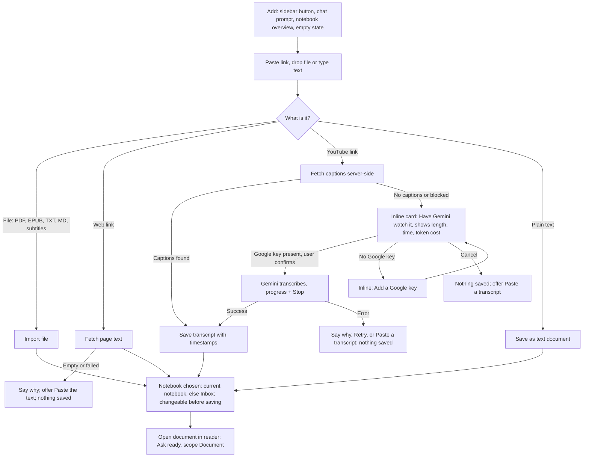

# better-vault redesign: UX brief (phase 2)

Traces to `requirements.md` (phase 1, signed off). Structure, flow and content only; no visuals. Requirement references use the requirements' own words: **Must** items by name, scenarios as S1–S5.

## 1. Concept summary

**The Open Desk, with a guided start and a chat that acts.** Every document lives in one visible notebook (Inbox by default), and the notebook is the desk: the main column shows the notebook's overview or one open document, and a **companion panel** beside it holds three tabs: **Ask** (the one chat, with a scope chip), **Practise** (an exercise with the material already chosen) and **Make** (Studio, outputs, cards). An app-wide sidebar frames everything: vault switcher, Study (Today, Practice, Review, Library), Notebooks, Tools, and one global **Add**. From the guided-loop concept, **Today** names one next step and its reason, and **Practise this** sits on every piece of material, so the first question is the second click. From the conversation-first concept, the one chat accepts links and files, lists every action under "/", and creates things on request with Undo, asking first only when something is slow or paid.

**Mental model:** "My material sits on one desk. Beside whatever I'm reading, I can ask, practise or make. Today tells me where to start; Review keeps what I learned."

### Rejected concepts and why they lost

| Concept | Why it lost |
|---|---|
| **A alone** (material-first workspace) | Strong for understanding, but practice had no home of its own: no place to choose freely across notebooks, no single practice history, and nothing pulling a returning learner toward the top job. |
| **B** (guided loop with per-section paths) | Forced read → practise → review paths fail for non-linear material (reference books, videos, notes) and turn a calm app into a nagging one. We kept only its Today step and its transparent ranking. |
| **C** (conversation-first) | Reading becomes secondary to a thread, every action leans on a capable AI (weak with local models and with no key), and long threads get noisy with creations, practice and questions mixed together. We kept the Add/link handling, "/" commands and creation with Undo. |

## 2. User journey map

| Stage | User goal | Actions | Thoughts and feelings | Pain points (today or risk) | Opportunities |
|---|---|---|---|---|---|
| **Discovery** | Find a calm way to learn from my own books and videos, with my own model | Reads the site or README, installs the desktop app | "Is this another NotebookLM clone? Will it work with my key or local model?" | Onboarding never says what the app is for | First screen states the promise in one sentence: bring material, understand it, practise it, remember it |
| **First run** | Get in without a long setup | Name, choose AI (or skip) | Impatient; wary of forms and accounts | Four-step setup with account and username steps | Two short steps (profile, AI), AI skippable, ending on the Add box |
| **First material** | See my material inside the app and ask about it | Pastes a YouTube link or drops a PDF | "Did it work? Where did it go?" | YouTube saves an empty page; books create hidden notebooks | One box, visible progress, lands in Inbox, opens in the reader with Ask ready; under 30 seconds to the first question (S1) |
| **First practice** | Prove to myself I understood | Presses Practise this, answers, finishes | Slightly anxious; wants it short and clear | Six exercise cards, four option groups, no clear end | Defaults (explain it back first), fixed length, clear Finish, one results screen with next step (S3) |
| **First week** | Come back and pick up where I was | Opens app on Today, does the step, reviews cards | "What should I do now?" | Today says "done" on day one; four chats, unclear homes | Today's one step with its reason; one deck; one chat history |
| **Day 100** | Keep a steady habit across several subjects | Today, a review round, a practice, adds new material to the right notebook, switches vault | Routine; wants speed and no noise | Feature sprawl, hidden features, invisible vault scope | Quiet per-notebook progress, "/" for power use, vault always visible, Tools hideable |

## 3. User flows

### (a) Add material via any link, file or text

Notes: the notebook field is shown in the Add box with its default, so choosing never costs a step. Adding several files adds them all to the chosen notebook and opens the first. A link pasted into the chat prompt runs the same importer and shows the result as a card in the thread ("Added to Inbox · Open · Undo"). Long books and long videos show size and, for Gemini, time and token cost before anything runs.

### (b) Understand: read, select, ask with scope

1. Open a document (Notebooks, Library, Today's "Continue reading", or a citation).
2. Read; the companion panel can stay open on Ask with scope **Document** (or **Chapter** in chaptered material).
3. Select a sentence: the selection menu offers Highlight, Translate, Listen, Save word, Make card, Note, **Ask**.
4. Ask sets the chip to **Passage**, quotes the selection in the prompt and focuses the input. The answer cites passages `[n]`; citations jump within the reader.
5. The user widens the chip (Chapter → Document → Notebook → Everything) at any time; the next answer uses the new scope.

Alternatives: ask without selecting (scope = current default); on phones, Ask opens the full-screen sheet with the passage quoted, and closing it returns to the same reading position. Translate and Save word work without AI only if a local translation exists; otherwise they show the inline AI fix (flow i). Failure: a slow answer shows progress and Stop; an error keeps the typed question and offers Retry.

### (c) Practise

**From a document or chapter (two clicks):**
1. Press **Practise this** in the document header (or on a chapter, or a notebook overview). The companion opens on Practise with material filled in and the default exercise selected: **Explain it back** the first time for this material, **Questions** afterwards.
2. Press **Start**: the first question or prompt appears in the main column.
3. Answer by typing or by voice (mic button; transcript appears for editing before sending).
4. Progress shows "3 of 5". **Finish** is always visible; ending early still produces results for what was answered.
5. **Results:** score, what you missed (each linked back to its passage), **Add the N you missed as cards**, and one next step.
6. The run appears as one summary row in the Ask history and in Practice history.

**From Today:** the next-step card's **Start** begins the exercise directly (one click).

**From the Practice page (free choice):** choose material (any notebook, document, chapter, or several across notebooks) → exercise (Questions, Explain it back, Role-play) → Start. "More options" (length, difficulty, role-play setting, answer mode) stays collapsed.

Alternatives: role-play asks for one setting (meeting, interview, conversation in a language) with a sensible default. Failure/recovery: no AI → inline fix in the Practise tab, Start disabled with the reason shown; the AI fails mid-run → the answered items are kept, Retry continues; leaving mid-run → the session is saved as unfinished and becomes Today's top step ("Resume your practice on chapter 2").

### (d) Remember: daily review

1. Today shows "12 cards due" in Then, or the user opens **Review**.
2. **Start review**: one card at a time, Show answer, grade (Again, Hard, Good, Easy; keys 1–4).
3. Words and cards come in one queue, grouped by notebook in the order of their notebooks' due counts.
4. End screen: count reviewed, the items found hard, one next step ("Practise the 3 hard ones", or "Continue reading X").

Alternatives: review one notebook only (from its overview: "Review this notebook"); browse the deck without reviewing. Empty: "Nothing due. Make cards from something you read" with the last-read document. Failure: a broken card is skipped with a quiet note, never breaking the queue.

### (e) Ask the chat to create something

1. **Tool-capable model:** "turn this chapter into flashcards" → cards are created at once into the one deck under this notebook. The answer shows a result row: "12 cards added to Biology · Open · Undo". Studio outputs (quiz, mind map, report) open beside the chat in the main column, with the same row in the thread.
2. **Local model without tools:** typing "/" lists every action (Make cards, Quiz, Mind map, Report, Note, Practise, Add). Choosing one runs it with the current scope as material; the result is identical to step 1. If the user asks in words, the answer ends with a hint: "To make cards with this model, type /cards".
3. **Slow or paid creation** (audio overview, images): a confirm card appears in the thread with what will be made, from what, which model or voice, estimated time and cost, and **Make it** / Cancel. Nothing runs until confirmed.
4. **Undo** removes what was created, at once, from the result row (and from a toast for a few seconds). After that, items are removed in their normal place.

Failure: generation fails → result row says what failed and offers Retry; partial results (e.g. 8 of 12 cards) are kept and said. Missing key for the image model → the confirm card shows "Add a key" instead of Make it.

### (f) Daily return via Today

1. App opens on Today in the last-used vault.
2. **Next step** with its reason, chosen by the transparent rule: resume an unfinished session → practise something read in the last 48 hours → due cards → continue reading → start new material.
3. **Start** runs it. **Not today** hides it until tomorrow and promotes the next. **Choose something else** shows all candidates with their reasons, plus the Practice page.
4. **Then** (at most three): due cards, continue reading, another candidate.
5. After finishing steps: "That's today's plan. Choose something else if you want more." Only shown after something was done today.

Alternatives: nothing to study and no material → the app opens on Notebooks (Inbox with Add); Today shows "Add your first material" if visited.

### (g) First run

1. **Welcome:** what the app is for, in one sentence; Continue.
2. **Profile:** name and interface language (English now).
3. **AI:** pick a provider and paste a key, sign in with ChatGPT (desktop), choose a local model, choose Better Vault AI (creates an account only on this choice), or **Skip for now**.
4. **Add your first material:** the Add box (link, file or text), Inbox preselected. "Skip, I'll add later" goes to Notebooks.
5. After adding: the document opens with a one-time strip under its header: "You can ask about it, practise it, or make cards from it", pointing to the three companion tabs. Dismissing it is permanent.

Failure: import fails → same recovery as flow (a), still inside onboarding; AI skipped → Ask shows the inline fix on first use.

### (h) Switching vaults

1. The sidebar's top shows the current vault's name; click it.
2. Menu: vaults list (current marked), New vault, Manage vaults.
3. Choosing a vault re-scopes everything: sidebar notebooks, Today, Practice, Review, Library, Notes, Calendar, Bots, Skills, the chat's "Everything" scope.
4. If the open page belongs to the old vault (a notebook, a document), the app goes to the new vault's Today.

Alternative: opening a link or citation to material in another vault switches vault with a notice ("Switched to Languages") and Undo. New vault → its empty Today/Notebooks invite Add.

### (i) No AI set up, or an AI error

1. Any AI action without a usable model shows the fix **inline, where it happened**: "Add a key" (opens the provider's key field in Settings as a sheet, then returns) or "Choose a model" (opens the model picker in place).
2. The rest keeps working: reading, highlights, words, manual cards, review, notes, Calendar, Library.
3. Disabled AI controls always say why on the control itself, never silently.
4. During a call: progress, Stop, and on failure a plain message (rate limit, invalid key, model not found, offline) with Retry and the matching fix. Typed input is never lost. Keys never appear in messages.

## 4. Information architecture

### Navigation model

- **Global (sidebar, collapsible, a drawer on phones):** vault switcher · **Add** · Study: Today, Practice, Review, Library · Notebooks: Notes, Inbox, the notebook tree (folders kept) · Tools: Calendar, Bot, Skills (the group can be hidden in Settings) · Settings and account at the foot.
- **Contextual (inside a notebook):** a single page header (notebook name with its menu, breadcrumb to the open document, **Practise this**, the companion toggle). The main column holds the overview, one document, or one Studio output. The companion panel holds Ask, Practise, Make.
- **The companion panel** is also available on Study pages (Today, Practice, Review, Library) with Ask only meaningful there; its default scope outside a notebook is **Everything** (the current vault).
- **Settings** stays a sheet over any page.

### Route sketch

| Route | Shows |
|---|---|
| `/` | Today; redirects to `/notebooks` when the vault has no material |
| `/practice`, `/practice/:sessionId` | Practice page; a session (running, or its results when finished) |
| `/review`, `/review/session` | Review page (deck, filters); the review session |
| `/library` | All documents in the vault |
| `/notebooks` | Notebooks list (sort: Recent, Name) |
| `/notebook/:id` | Notebook overview |
| `/notebook/:id/doc/:sourceId` | Document reader (position in the hash) |
| `/notebook/:id/output/:outputId` | Studio output view |
| `…?panel=ask\|practise\|make&chat=:conversationId` | Companion panel state on any notebook route |
| `/notes`, `/notes/:noteId` | Notes |
| `/calendar`, `/bots`, `/skills` | Tools |

The vault is not in the URL; it is current state, and an id from another vault switches vault (flow h).

### What happens to today's routes and sections

| Today | Becomes |
|---|---|
| `/?view=study` and `/study` tabs | Redirect to `/`, `/practice`, `/review`, `/library` |
| Home "All notebooks" | The Notebooks list and the sidebar tree |
| Home "Recent" | The Recent sort on Notebooks, and "Continue reading" on Today |
| Study reader and notebook source reader | One document reader at `/notebook/:id/doc/:sourceId` |
| Notebook Chat tab, reader "Ask AI", tutor sessions | The one Ask tab and its one history |
| Notebook Sources / Studio tabs, top-bar Create sheet | Notebook overview (documents list), Make tab, output view |
| Reader panel Highlights, Words | The reader's **Contents** drawer (outline, highlights, words for this document) |
| Collection, "Browse" | The Review page's deck (filters: Cards, Words, Highlights to review; by notebook) |
| Vocabulary / Words | **Words** everywhere |
| Studio flashcard decks | Cards in the one deck (migrated) |
| Hidden book notebooks | Visible notebooks (migrated, named after the book) |
| Study activity list on Today | Removed from Today; quiet progress moves to notebook overviews (it served no requirement on Today) |

## 5. Screen inventory

Order follows the journey. **K** = key, **S** = supporting. "Primary" is the single main action.

### Onboarding: Welcome, Profile, AI (S)
- **Purpose:** get in fast, know what the app is for. Job: entry to all.
- **Primary:** Continue (Welcome, Profile); **Use this AI** (AI step). **Secondary:** Back, Skip for now (AI).
- **Content:** one-sentence promise; name; AI choices (provider + key, ChatGPT sign-in on desktop, local model, Better Vault AI) with one line each on cost and privacy.
- **States:** key check loading; invalid key error inline; local server not found ("Start Ollama/LM Studio, then Check again").
- **Obvious:** two short steps, AI is optional.

### Onboarding: Add your first material (K)
- **Purpose:** the first material, the first value. Job: all three.
- **Primary:** Add. **Secondary:** Skip, I'll add later.
- **Content:** the Add box; examples ("a YouTube lecture, a PDF, an article, your notes"); notebook preset to Inbox.
- **States:** same as Add. Success opens the document with the one-time "what you can do" strip.
- **Obvious:** one box takes anything.

### Add (K)
- **Purpose:** bring any material into one notebook. Job: understand (feeds all).
- **Primary:** Add. **Secondary:** change notebook, More (record or paste a transcript, new empty notebook).
- **Content:** one input ("Paste any link, drop a file, or type text"); detected type in plain words ("YouTube video · captions"); notebook field (current notebook, else Inbox).
- **States:** empty (examples); detecting; importing (progress, Cancel); YouTube without captions (Gemini card: length, time, token cost, Google key status); error (why, and what to do; nothing saved); success (closes and opens the document).
- **Obvious:** what was detected and where it will go.

### Today (K)
- **Purpose:** know what to do now. Jobs: practise, remember, understand.
- **Primary:** **Start** on the next step. **Secondary:** Not today, Choose something else, the Then items.
- **Content:** next step (action, material, reason) → Then (max three) → a quiet line per active notebook only if it adds something (e.g. due counts in another vault, see open question 3).
- **States:** first time / no material: "Add your first material" with Add (never "done"); material but nothing due or recent: next step is "Continue reading" or "Start new material"; all steps done today: "That's today's plan" with Choose something else; loading: placeholders; one broken record is skipped.
- **Obvious:** one thing to do and why.

### Notebooks list (S)
- **Purpose:** see and open every notebook in the vault. Job: understand.
- **Primary:** New notebook. **Secondary:** Add, sort (Recent, Name), search, folders, rename/move/delete.
- **Content:** Inbox first, then notebooks with document count and a quiet progress line.
- **States:** empty vault: "This vault is empty" with Add as the one action; search with no match.
- **Obvious:** Inbox exists and is where things go by default.

### Notebook overview (K)
- **Purpose:** the notebook's desk: its material and how far you are. Jobs: all.
- **Primary:** **Practise this** (whole notebook). **Secondary:** Add to this notebook, Review this notebook, open a document, open an output, rename/delete.
- **Content:** documents (with reading progress) → quiet progress (cards known, last practice result; mastery line if built) → outputs → notes linking here.
- **States:** new notebook: "Add material to this notebook" with Add; deleting: confirmation naming what goes (material, chats, cards).
- **Obvious:** what is in it, and that it can be practised.

### Document reader (K, hero)
- **Purpose:** read and work on one document. Job: understand, entry to practise and remember.
- **Primary:** **Practise this** (scope follows the current chapter when there is one). **Secondary:** Contents drawer (outline, highlights, words), reading settings (Aa), Listen, search, companion toggle.
- **Content:** one header (notebook › document, Practise this, Contents, Aa, companion toggle) → text, PDF page, EPUB chapter, or for a YouTube video the embedded player above its timestamped transcript (synced both ways) → position.
- **Selection menu:** Highlight, Translate, Listen, Save word, Make card, Note, **Ask** (sets scope to Passage).
- **States:** loading, unreadable file (keep it, explain, offer recognize text), empty transcript impossible by design; first open: the one-time strip; RTL material reads right to left.
- **Obvious:** where I am, and that Practise and Ask are right here.

### Companion: Ask (K)
- **Purpose:** the one chat. Job: understand, and creation.
- **Primary:** Send. **Secondary:** scope chip, model picker, Sources/Web switch, "/" actions, attach/paste link, History, New chat.
- **Content:** thread with cited answers, footnoted references, answer actions (visible on touch and on older answers: Make cards, Note, Copy); result rows and practice summary rows; prompt.
- **States:** no AI (inline fix); no sources in scope ("Nothing selected to answer from. Widen the scope or add material"); streaming (Stop); error (Retry, fix); empty thread: three example asks for this scope plus "Type / to see what I can make".
- **Obvious:** what the answer is based on (the scope chip).

### Companion: Practise (K)
- **Purpose:** start practice on what is open. Job: practise.
- **Primary:** **Start**. **Secondary:** change material, change exercise, More options.
- **Content:** material (pre-filled) → exercise with default selected and a one-line reason ("You haven't explained this back yet") → recent results for this material.
- **States:** no AI (Start disabled, reason and fix shown); unfinished run ("Resume"); first time vs returning default.
- **Obvious:** one button away from the first question.

### Companion: Make (S)
- **Purpose:** produce from this notebook. Job: produce, remember.
- **Primary:** **Make cards** from the current scope. **Secondary:** Studio tools (each opens its dialog), this notebook's outputs, this notebook's cards.
- **States:** no outputs yet (tools still listed); generating (progress in the outputs list); error (Retry); local tools (Whiteboard) open at once.
- **Obvious:** cards go into the one deck.

### Chat creation confirm card (S)
- **Purpose:** prevent surprise cost. Job: produce.
- **Primary:** **Make it**. **Secondary:** Cancel, change options (voice, image model).
- **Content:** what, from what, model, estimated time and cost.
- **States:** missing key (Add a key replaces Make it); running (progress, Stop); done (becomes a result row).

### Studio output view (S)
- **Purpose:** see and use an output in the main column. Job: produce.
- **Primary:** depends on the tool's job (Play, Start quiz, Download). **Secondary:** rename, export, delete, Ask about this.
- **States:** generating, failed (Retry), broken record (error inside this output only).

### Practice page (K)
- **Purpose:** free choice and the one history. Job: practise.
- **Primary:** **Start practice**. **Secondary:** choose material (across notebooks), exercise, More options; open a past result.
- **Content:** suggestion (same rule as Today, filtered to practice) → material + exercise picker → history (date, material, exercise, score).
- **States:** no material ("Add material to practise on" with Add); no history yet ("Your results will appear here"); no AI (inline fix).
- **Obvious:** pick material and exercise, then Start; past results are here.

### Practice session (K)
- **Purpose:** do the exercise with focus. Job: practise.
- **Primary:** **Send answer** (or **Next**). **Secondary:** voice/typing switch, Skip, Show the passage, **Finish**.
- **Variants:**
  - **Questions:** one question at a time, answer, short feedback citing the passage.
  - **Explain it back:** a prompt, the learner explains, the tutor asks up to N follow-ups.
  - **Role-play:** a setting (meeting, interview, language conversation), turns with the tutor; a fixed number of turns.
- **Voice:** mic, live transcript editable before sending, Listen for the tutor's turn; falls back to typing with a reason if the microphone is denied.
- **States:** loading next item; AI error mid-run (keeps answers, Retry); leaving (saved as unfinished).
- **Obvious:** where I am (3 of 5) and how to finish. At most five controls visible at once.

### Results (K)
- **Purpose:** know how it went and what next. Jobs: practise → remember.
- **Primary:** **Add the N you missed as cards** (when N > 0); else the next step. **Secondary:** links to each missed passage, Practise again, Done.
- **Content:** score → what you missed (each with its passage link) → next step.
- **States:** all correct (next step becomes primary); ended early (results for answered items, said plainly); cards added (count, Undo).

### Review (K)
- **Purpose:** keep what you learned. Job: remember.
- **Primary:** **Start review** (N due). **Secondary:** filter by notebook, browse the deck (Cards, Words), add a card.
- **Session:** card, Show answer, four grades; end screen with hard items and one next step.
- **States:** nothing due (next-due time and "Make cards from something you read"); empty deck ("Save words or make cards while reading"); broken card skipped.
- **Obvious:** how many are due, one button.

### Library (S)
- **Purpose:** every document in the vault in one list. Job: understand.
- **Primary:** Add. **Secondary:** search, filter by notebook or type, open, continue reading.
- **Content:** documents with their notebook named on each, reading progress.
- **States:** empty (Add). Obvious: each document's one home.

### Vault switcher (S)
- **Purpose:** see and change the scope. **Primary:** choose a vault. **Secondary:** New vault, Manage.
- **Obvious:** the current vault's name is always visible at the top of the sidebar.

### Settings (S)
- **Purpose:** configure once, rarely revisit. **Primary:** per group. Groups: **AI** (providers and keys, ChatGPT sign-in, models, Studio defaults, ElevenLabs), **Reading and voice** (translation language, reading voice), **Account and plan**, **Storage and data** (sync storage, backup, export, import), **Appearance and language**, **Tools** (show/hide Tools, Calendar subscriptions, MCP for skills), **About and updates**.
- **Obvious:** seven groups instead of 13 rows; a deep link opens the right group from any inline fix.

### Notes (S)
- **Purpose:** the vault's Markdown notes. Job: understand, produce.
- **Primary:** New note. **Secondary:** search, graph, backlinks, shortcuts.
- **Placement (recommended):** one **Notes** entry at the top of the Notebooks group, vault-wide. Notes link across notebooks with `[[links]]` and keep one graph; splitting them per notebook would break both. A notebook overview lists notes that link to it, and a note made from a passage links to its source automatically.
- **States:** empty ("Write your first note, or save one while reading").

### Tools pages (S)
Calendar, Bot and Skills keep their current pages, scoped to the current vault, under Tools. Bots stay separate from the one chat. Each empty state offers its one next step (Add an entry, New bot, New skill).

### Upgrade notice (S, one-time)
- **Purpose:** explain the move on first launch after the update. **Primary:** Got it. Content: "Your books now live in notebooks; your chats are in one history; all flashcards are in Review." Nothing else changes for the user. (Not in the concept; needed by the migration requirement.)

## 6. Hero screen

**The document reader with the companion panel open.** It carries the most weight because the three jobs meet there: Practise this (practise), selection to Words and cards (remember), reading with a scoped Ask (understand), and Make (produce). It contains the hardest structural problems: one header instead of three bars, a two-column layout that becomes a full-screen sheet on phones, the scope chip, the selection menu, and RTL material. Once it works, the other screens are subsets: Today and Results are single columns of cards and actions; the Practice session reuses Ask's conversation pattern; the notebook overview is the same frame with a list in the main column. Today is seen first each day, but it is too simple to set the design language, and setting it there would make the reader adapt to a list page rather than the other way round.

## 7. UX principles

1. **One home, many views.** Every item lives in exactly one notebook; Today, Library, Review and Practice only show it and link back to it.
2. **The next step is one click away.** Every piece of material has Practise this; every empty screen, result and review end offers exactly one next step.
3. **Asking is enough.** Anything the app can make can be asked for in the chat or found under "/". No action exists only behind a hover or a hidden menu.
4. **Quiet, and honest about cost.** Cheap things happen at once with Undo; slow or paid things say time and cost first. No streaks, no badges, no guilt.
5. **Works without AI.** Reading, words, cards, review and notes never wait on a model; AI problems are fixed inline, where they happened.

### Voice and tone

Calm and focused: short sentences, plain verbs, second person, sentence case, no exclamation marks. Give reasons, not pressure ("You read it yesterday", not "Don't lose your progress"). Praise is factual ("4 of 5 right"). Errors say what happened and the fix, with a button. Empty states say what the screen is for and the one thing to do. Never say "done" before something was done.

**Glossary (fixes naming drift):** **Ask** is the only label for the AI chat. **Practise** (verb, buttons) and **Practice** (the page, a session). **Make** (create), **Add** (material in). **Cards**, **Words** (never Vocabulary), **Review** (never Browse or Collection), **Notebook**, **Inbox**, **Document** (the user's word for a source), **Output** (Studio result).

## 8. Requirements trace

| Must have | Served by |
|---|---|
| One home: the notebook; Today, Library, Review as views; Inbox default; hidden notebooks visible | IA, Add, Notebooks list, Library, upgrade notice; flow (a) |
| One AI conversation with scope and one history | Companion Ask, scope chip, practice summary rows; flow (b) |
| Chat creates anything; Undo; confirm for slow/paid; "/" for local models | Ask, confirm card, Studio output view; flow (e) |
| One flashcard deck, grouped by notebook | Review, Make tab, Results; flows (d), (e) |
| One Practice model, defaults, two clicks, one results screen | Practise tab, Practice page, session, Results; flow (c) |
| YouTube captions, Gemini fallback, one link box, never empty | Add, Gemini card; flow (a) |
| Notebook page uses the app layout; Study/Notebooks/Tools; visible vault switcher | IA, sidebar, vault switcher; flow (h) |
| Home: Today, else notebooks | Today, route `/`; flow (f) |
| Onboarding ends on Add, then what you can do | Onboarding screens; flow (g) |
| Quiet progress per notebook, no streaks | Notebook overview, Notebooks list; principle 4 |
| AI errors inline; non-AI keeps working; every empty screen has a next step | Flow (i); states on every screen |
| Quick fixes: false "done", Make tab, triple nav, naming, Settings groups, silent disabled buttons | Today states, Make tab, reader header, glossary, Settings groups, flow (i) step 3 |
| Quick fix: hard-coded English in the tutor | **No screen**: an implementation task in the Practice session work |
| Phone at 390px; RTL in material | Sidebar drawer, companion as sheet; reader states |
| Should: mastery line; answer actions on touch; error boundaries | Notebook overview; Ask; "broken record" states |

**Gaps and flags:**
- Migration needs a screen the concept didn't have: the one-time **upgrade notice** (added).
- Highlights and words of a document needed a place once the reader panel became three tabs: the reader's **Contents** drawer (added).
- Today's **Recent activity** list and the onboarding **account/username** steps serve no requirement: removed from Today; the account moves into the AI step as one choice (open question 5).
- Notebook **folders** and the Notes **graph** serve no requirement but exist today; kept so nothing is lost.
- "Review all vaults" conflicts with "the vault scopes everything" (open question 3).

## 9. Decisions on the open questions (owner, phase 2)

| Question | Decision |
|---|---|
| Where do Notes live? | One vault-wide **Notes** entry at the top of the Notebooks group; a notebook's overview lists the notes that link to it. |
| Do highlights go into review? | Only when the learner chooses **Review this**, which turns the highlight into a card in the one deck. Highlights already in review migrate as cards, so nothing is lost. |
| "Review all vaults" | Removed. Review is per vault; Today shows one quiet line when another vault has cards due ("8 due in Languages · Switch"). |
| YouTube player | **Embedded player** beside the transcript, synced with it: clicking a timestamp seeks the player, and the transcript follows playback. This needs YouTube's embed host added to the app's Content-Security-Policy (`frame-src`) and testing in the desktop app. If the player can't load (offline, blocked), the transcript still works and timestamps open the video in the browser. |
| Account in first run | Inside the AI step: Better Vault AI is one choice, and choosing it signs you in. First run stays at two short steps. |

## 10. Open questions

None at the end of phase 2.
